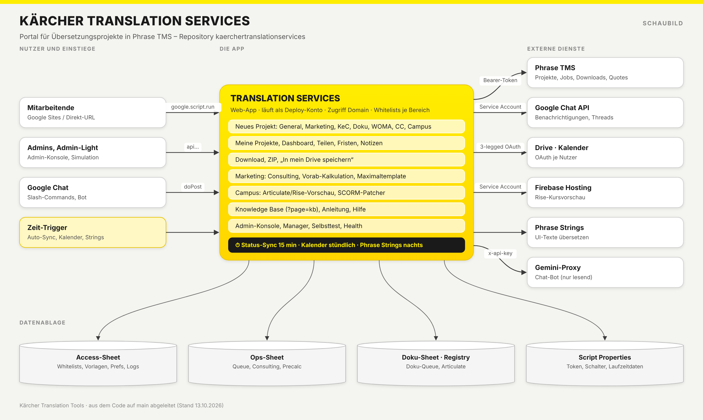

# Dokumentation – Kärcher Translation Services

Diese Dokumente beschreiben das Portal so, dass ein Mensch **oder ein KI-Modell** ohne den
kompletten Quellcode damit arbeiten kann: Oberfläche nachbauen oder erweitern, Endpunkte
aufrufen, Berechtigungen verstehen und typische Fehler vermeiden.

Stand: aus dem Code auf `main` abgeleitet (Commit `27ad1b9`). Bei Widersprüchen gilt der Code.

| Datei | Inhalt | Wann lesen |
|---|---|---|
| [`ARCHITEKTUR-UND-DATEN.md`](ARCHITEKTUR-UND-DATEN.md) | Systemüberblick, Dateien, Sheets (Datenmodell), Script Properties, Trigger, Deploy, Tests | Immer zuerst – der Rahmen für alles andere |
| [`API.md`](API.md) | Aufrufmodell (`google.script.run`), Authentifizierung & Rollen, alle `api*`-Endpunkte, HTTP-Einstiege, externe APIs (Phrase TMS, Phrase Strings, Google Chat, Drive, Kalender, Firebase, Gemini) | Wenn Server-Funktionen aufgerufen, geändert oder neu gebaut werden |
| [`UI-UX.md`](UI-UX.md) | Designsystem „Kaercher Glass“, Layout, Navigation, Bildschirme, Abläufe, Zustände, Sprachen, Barrierefreiheit, UI-Regeln | Wenn an der Oberfläche gearbeitet wird |
| [`AUFFAELLIGKEITEN.md`](AUFFAELLIGKEITEN.md) | Beim Analysieren gefundene Fehler, Namenskonflikte und Sicherheitslücken | Vor Änderungen an Berechtigungen, Downloads oder doppelt definierten Funktionen |
| [`STYLEGUIDE.md`](STYLEGUIDE.md) | Verbindliche Regeln für Doku, Code, Oberfläche („Kaercher Glass“) und CI/CD **aller** Kärcher-Translation-Repos | Bei jeder Änderung, bei neuen Projekten |
| [`SCHAUBILD.png`](SCHAUBILD.png) / [`.svg`](SCHAUBILD.svg) | Architekturbild des Portals | Zum Einstieg |
| [`gesamt/GESAMTUEBERSICHT.md`](gesamt/GESAMTUEBERSICHT.md) | Alle neun Repositories im Zusammenhang: Systemlandkarte, alle Datenbanken, Phrase-Objekte, Gemini, Trigger, Abläufe, Rollen, Glossar, FAQ | Für projektübergreifende Fragen |
| [`gesamt/SYSTEMLANDKARTE.png`](gesamt/SYSTEMLANDKARTE.png) / [`.svg`](gesamt/SYSTEMLANDKARTE.svg) | Grafik aller Systeme, Datenablagen und Verbindungen | Zum Einstieg |

## Einem Modell übergeben

Für die meisten Aufgaben reichen `ARCHITEKTUR-UND-DATEN.md` + die passende Fachdatei.
Ein Vorschlag für den Einstieg in den Prompt:

> Du arbeitest am Kärcher-Translation-Services-Portal, einer Google-Apps-Script-Web-App
> (V8, kein Build-Schritt, kein npm im Laufzeitcode). Die angehängten Dokumente beschreiben
> Architektur, Endpunkte und Oberfläche. Halte dich an die Regeln in „Harte Grenzen“
> (ARCHITEKTUR-UND-DATEN.md) und „Regeln für Änderungen an der Oberfläche“ (UI-UX.md).
> Jede neue Server-Funktion, die der Browser aufruft, prüft die Berechtigung selbst
> (siehe API.md, „Berechtigungsmuster“).

Keine dieser Dateien enthält Zugangsdaten. Token, Schlüssel, Client-Secrets und
Sheet-IDs stehen nur in den Script Properties bzw. im Code und gehören nicht in Prompts.
