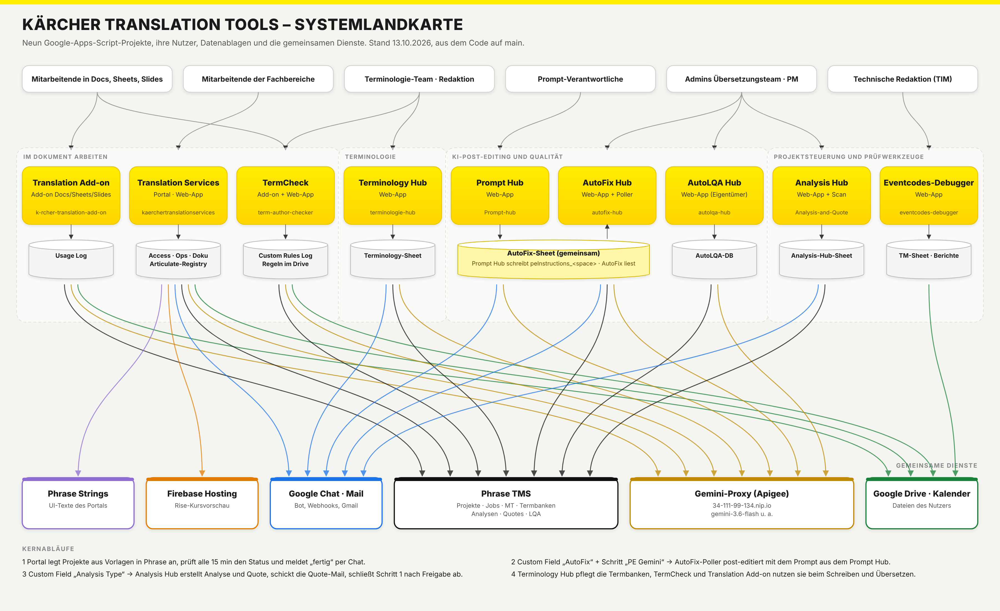

# Kärcher Translation Tools – Gesamtübersicht

Diese Datei beschreibt die neun GitHub-Repositories von `MMario996` rund um Übersetzung,
Phrase TMS und Gemini bei Kärcher **im Zusammenhang**. Sie ist so geschrieben, dass ein Mensch
oder ein KI-Assistent (NotebookLM, Gemini Gem) Fragen beantworten kann wie „Welche Datenbank
steckt hinter dem AutoFix Hub?“, „Wo stelle ich das Gemini-Modell ein?“ oder „Was passiert,
wenn ein Projekt das AutoFix-Flag bekommt?“.

Stand: aus dem Code der Branches `main` abgeleitet (13.10.2026). Bei Widersprüchen gilt der Code.
Details zu jedem Projekt stehen in dessen `docs/`-Ordner (gleicher Aufbau überall, siehe
[`STYLEGUIDE.md`](../STYLEGUIDE.md)).



---

## 1. Die neun Repositories auf einen Blick

| # | Repository | Produktname | Art | Zweck in einem Satz |
|---|---|---|---|---|
| 1 | `kaerchertranslationservices` | **Kärcher Translation Services** (Portal) | Web-App, eingebettet in Google Sites | Mitarbeitende legen Übersetzungsprojekte in Phrase TMS an, verfolgen, teilen und laden sie herunter – ohne eigenen Phrase-Zugang. Dazu Knowledge Base, Chat-Bot, Campus/Rise-Vorschau, Marketing-Consulting und Vorab-Kalkulation. |
| 2 | `autofix-hub` | **AutoFix Hub** | Web-App + Zeit-Trigger (nur Admins) | Post-editiert automatisch Phrase-Jobs im Workflow-Schritt „PE Gemini“ mit Gemini, schreibt die Korrekturen zurück und wertet sie nach MQM aus. |
| 3 | `Prompt-hub` | **Prompt Hub** | Web-App | Pflege, Prüfung, Live-Test und Versionierung der Post-Editing-Prompts, Styleguides und Kontext-Dateien, die AutoFix verwendet. |
| 4 | `autolqa-hub` | **AutoLQA Hub** | Web-App (nur Eigentümer) | KI-gestützte Qualitätsprüfung (LQA nach DQF-MQM) von Phrase-Projekten; Befunde als Kommentar oder LQA-Assessment zurück nach Phrase. |
| 5 | `Analysis-and-Quote` | **Analysis Hub** (Analysis & Quotes) | Web-App + Zeit-Trigger | Erstellt für neue Phrase-Projekte automatisch Analyse und Quote, verschickt die Quote-Mail, schließt nach Freigabe Schritt 1 ab und meldet die Fertigstellung. |
| 6 | `terminologie-hub` | **Terminology Hub** | Web-App + Zeit-Trigger | Termbanken in Phrase durchsuchen und pflegen, Begriffe vorschlagen und freigeben, Übersetzungsprojekte für Begriffe anlegen, KI-Vorschläge und Begriffsnetz. |
| 7 | `term-author-checker` | **Kärcher TermCheck** | Workspace-Add-on (Docs, Sheets, Slides, Drive) + Web-App | Terminologiesuche in Phrase-Termbanken und „Author Check“ (Grammatik, Terminologie, Stil) mit Gemini, auch für PDFs in Drive. |
| 8 | `eventcodes-debugger` | **Eventcodes-Debugger** | Web-App | Prüft TIM-Exporte (SW-Text- und Eventcodes-XML) vor und nach der Übersetzung: Import-Check, Diff, Zeichenlimit, Pixelbreite, TM-Sheet-Sync. |
| 9 | `k-rcher-translation-add-on` | **Kärcher Translation Add-on** | Workspace-Add-on (Docs, Sheets, Slides) | Übersetzt Inhalte direkt im Dokument über Phrase MT, mit Gemini als Ausweich und optionalem Gemini-Post-Editing. |

Alle Projekte sind **Google Apps Script (V8)**, laufen in der Workspace-Domain `karcher.com`,
nutzen **Google Sheets als Datenbank** (außer Eventcodes-Debugger und Add-ons) und sprechen
mit **Phrase TMS** (`https://cloud.memsource.com/web`, früher Memsource). Die KI-Funktionen laufen
über den **Kärcher-Gemini-Proxy (Apigee)**
`https://34-111-99-134.nip.io/gemini/v1beta/models/<modell>:generateContent` mit dem Header
`x-api-key: <GEMINI_API_KEY>`.

---

## 2. Systemlandkarte

Die Grafik `SYSTEMLANDKARTE.png` (Quelle `SYSTEMLANDKARTE.svg`) zeigt alle Projekte, Dienste und
Datenablagen. Als Text:

```
NUTZER (karcher.com)
  Mitarbeitende ─────────────► Translation Services (Portal) ──► Phrase TMS (Projekte, Jobs, Download)
  Mitarbeitende in Docs/Sheets/Slides ─► Translation Add-on ──► Phrase MT ─(Ausfall)─► Gemini
  Autorinnen, Redaktion ─────► TermCheck (Add-on + Web-App) ──► Phrase-Termbanken, Gemini
  Terminologie-Team, PMs ────► Terminology Hub ──► Phrase-Termbanken, -Projekte, -Glossare, Gemini
  Prompt-Verantwortliche ────► Prompt Hub ──(veröffentlicht peInstructions_<space>)──► AutoFix-Sheet
  Admins Übersetzungsteam ───► AutoFix Hub ◄──(liest Prompts)── AutoFix-Sheet
                                 └─ Poller ──► Phrase (MXLIFF holen/hochladen) + Gemini (PE, MQM)
  Admins / Projektmanagement ► Analysis Hub ──► Phrase (Analyse, Quote, Mail, Schritt 1)
  Qualitätsmanagement ───────► AutoLQA Hub ──► Phrase (Segmente, Kommentare, LQA) + Gemini
  Technische Redaktion ──────► Eventcodes-Debugger ──► Google Drive (TIM-XML) – kein Phrase

GEMEINSAM
  Phrase TMS  ·  Gemini-Proxy (Apigee)  ·  Google Chat (Bot/Webhooks)  ·  Google Sheets  ·  Drive
```

### Wie die Projekte zusammenhängen

1. **Portal → Phrase:** Das Portal legt Projekte aus Phrase-Vorlagen an (technischer API-Nutzer),
   macht den Einreicher zum Owner und prüft den Status alle 15 Minuten.
2. **Phrase → AutoFix:** Hat ein Projekt das Custom Field **„AutoFix“** gesetzt und Jobs im
   Workflow-Schritt **„PE Gemini“** (Status NEW/ACCEPTED), holt der AutoFix-Poller einen Job,
   lässt Gemini post-editieren, lädt die Datei zurück und setzt das Flag nach dem letzten Job zurück.
3. **Prompt Hub → AutoFix:** Der Prompt je Dokumenttyp („Space“) wird im Prompt Hub gepflegt und
   beim Veröffentlichen in genau die Zeile `peInstructions_<space>` im Tab `Settings` des
   AutoFix-Sheets geschrieben, die AutoFix liest. Neue Spaces landen im Tab `Prompt Spaces`.
4. **Translation Add-on ↔ AutoFix:** Das Add-on nutzt für seinen optionalen Gemini-PE-Schritt
   dieselben Post-Editing-Prompts (als Kopie fest im Code, `GEMINI_PE_PROMPTS_` in `Api.gs`).
5. **Portal ↔ Analysis Hub:** Unabhängige Apps-Script-Projekte. Der Analysis Hub reagiert auf
   Projekte mit dem Custom Field „Analysis Type“, egal, wer sie angelegt hat. Das Portal hat eine
   eigene **Vorab-Kalkulation** (Marketing) in festen Kalkulationsprojekten.
6. **AutoLQA:** Unabhängig von AutoFix; prüft fertige Übersetzungen nach MQM und schreibt Befunde
   zurück nach Phrase. AutoFix hat zusätzlich eine eigene MQM-Auswertung seiner Korrekturen.
7. **Terminology Hub ↔ TermCheck:** Beide lesen dieselben Phrase-Termbanken. Der Terminology Hub
   **pflegt** sie (Vorschläge, Freigabe, Übersetzung, Import), TermCheck **nutzt** sie beim
   Schreiben und Prüfen.
8. **Portal-Knowledge-Base:** Die komplette Phrase-Dokumentation als eigene Seite
   (`?page=kb`) des Portals.
9. **Eventcodes-Debugger:** Fachlich unabhängig; gleiche Google Site und gleiches Design.

---

## 3. Alle Datenbanken (Google Sheets)

> Link-Muster: `https://docs.google.com/spreadsheets/d/<ID>/edit`

| Datenbank | Sheet-ID | Gehört zu | Konfiguriert über | Tabs (Auszug) |
|---|---|---|---|---|
| **Access-Sheet** („Sync DB“) | `1mU8zWhR-E8_fmBcLtMh1qIwST9FibKT5UfH7oaivs0Q` | Portal | Script Property `ACCESS_SHEET_ID` (Fallback `Config.gs`) | `Whitelist*`, `FetchTemplate-Prod`, `FetchTMS_USERS-Prod`, `Maintenance`, `Notifications`, `UserPrefs`, `CalendarSync`, `User_Presets`, `Announcements`, `NotificationLog`, `AuditLog`, `Message_Templates`, `Watchers`, `Deputies`, `PivotTemplateLinks`, `PivotLanguageMap`, `Prompt_Hub` |
| **Ops-Sheet** („Uploads DB“) | `1xi0ZtFxxurNu25URrhpHmfSLy8nld_SXm0KmkXxRCpQ` | Portal | `OPS_SHEET_ID` (Fallback `Config.gs`) | `Queue` (eine Zeile pro Phrase-Projekt), `Consulting_Requests`, `Precalc_Log` |
| **Dokumentations-Sheet** | `1_EFW_ItawRvutiVrcNIamKTSYPFsA5XFGR1s6PctYxs` | Portal (Dokumentation) | fest im Code (`DocQueue.gs` u. a.) | `Queue`, `Board`, `Archive` |
| **Articulate-Registry** | `1V6oyZVw7-CPy8Bs5_sGl9Cg886b2T6r7FLGgp1gfBRY` | Portal (Campus) | fest im Code (`Articulateregistry.gs`) | `Projects` |
| **AutoFix-Sheet** („AutoFix Hub - Database“) | `1LFoBCuz7h1xdi58djRPedAXgtj4RZ_T5EnvJbTKtkp8` (Standard im Prompt Hub) | AutoFix Hub **und** Prompt Hub | AutoFix: `AUTOFIX_DB_SHEET_ID` (fehlt sie, legt AutoFix ein neues Sheet an). Prompt Hub: `PH_CONFIG.autofixSheetId` | `Settings`, `Run Log`, `Audit Log`, `Prompt Spaces`, `Styleguides`, `Prompt Hub Import`, `PH_Spaces`, `PH_Versions`, `PH_Users`, `PH_Requests`, `PH_TestCases`, `PH_Audit`, `PH_Styleguides` |
| **MQM fortlaufend** | nicht im Code | AutoFix Hub | `MQM_WEEKLY_SHEET_ID`, Ordner `1SL1XcERYH_GlljHcH2RDfXT-oBcI58UQ` (`MQM_FOLDER_ID`) | `Details`, `Wochen`, `Übersicht` |
| **AutoLQA-Datenbank** | nicht im Code, wird beim ersten Start angelegt | AutoLQA Hub | `DB_SHEET_ID` | `Settings`, `Profiles`, `Reports`, `Issues`, `Audit Log`, `Run History`, `LQA Export` |
| **Analysis-Hub-Sheet** | `1Jedm88GqXBp1-QxQCD-hgfQZO1007YVIdgXA_GOpiEY` | Analysis Hub | fest im Code (`SYSTEM_CONFIG.SPREADSHEET_ID`) | `App_Config`, `App_Routing`, `App_OptionMapping`, `Webhook_Analysen_v2`, `Webhook_Queue`, `Webhook_Log`, `Archiv_Analysen`, `Archiv_Queue`, `App_Audit` |
| **Terminology-Hub-Sheet** | nicht im Code | Terminology Hub | `TERM_CHECK_SHEET_ID` | `Settings`, `TermSuggestions_v2`, `MailQueue`, `TermCheckProjects`, `GlossaryUploadLog`, `AuditLog` |
| **TermCheck Custom Rules Log** | nicht im Code | TermCheck | `CUSTOM_RULES_LOG_SHEET_ID` | `Custom` |
| **Add-on Usage Log** | nicht im Code | Translation Add-on | `ADMIN_USAGE_LOG_SHEET_ID` (`ADMIN_createUsageLogSheet()`) | `Usage Log` |
| **TM-Sheet** (frei wählbar) | Eingabe in der App | Eventcodes-Debugger | – | `TM` (Spalte je Sprache) |

Zwei Dinge heißen „Prompt Hub“: das Repository **Prompt-hub** (Tabs `PH_*` im AutoFix-Sheet)
und das Tab **`Prompt_Hub`** im Access-Sheet des Portals, aus dem das „Maximaltemplate“ Prompts
für das Phrase-Custom-Field „AI Prompt“ liest. Beide sind nicht verbunden.

---

## 4. Phrase-TMS-Objekte, die im Code verdrahtet sind

| Objekt | UID / Wert | Verwendet von | Bedeutung |
|---|---|---|---|
| Custom Field **AutoFix** | `1uw8kvE6WNhT6Gw0XeX4Z4` | AutoFix (Setting `cfFieldUid`) | Projekt soll post-editiert werden; die Option bestimmt den Prompt-Space |
| Option „True“ (Legacy) / „Technical Documentation“ | `7d95rL0n0lA894J0CRXaL9` / `2HtFqxLWLZp3126BkQ6li1` | AutoFix | → Space `technical` |
| Option „Marketing“ | `YddgPfvnHZ8A4li6KxmYS2` | AutoFix | → Space `marketing` |
| weitere Optionen (z. B. „Campus“, „P&D“) | – | AutoFix | über den **sichtbaren Optionstext** dem gleichnamigen Space zugeordnet; unbekannt → `technical` |
| Workflow-Schritt | `PE Gemini` | AutoFix (`wfStepName`) | nur Jobs in diesem Schritt mit Status NEW/ACCEPTED |
| Custom Field **Analysis Type** | `s3rkXsPVn38K9t1dI0fRc7` | Analysis Hub (`CF_ANALYSIS_TYPE_UID`) | wählt das Routing (Analyse-Art, Preisliste, Mail-Vorlage) |
| Quote-Mail-Vorlage, Workflow-Schritt | `tg5BURQ9kGGj3tg0LUGHW1`, `1043109` | Analysis Hub | Standardwerte in `App_Config` |
| Fallback-Dienstleister | `1182021` | Analysis Hub | wenn der Projekt-Owner nicht passt |
| MT-Profile Marketing / Technical / General | `Zpfa4GJsY5rl4J9q070rV5` / `GrigHtkTDZUF4xYGWFmpI2` / `gC20LvuraAQGr2lXlrubL4` | Translation Add-on | Phrase „Add-on Marketing/Technical/General“ |
| Projektvorlagen Terminology check LLM / ALG | `pNoERiZ1YTileyUe4Za1j6` / `arpmvYCEAqGl0OmKV9f3s3` | TermCheck (`TEMPLATE_LLM`, `TEMPLATE_ALG`) | liefern die Sprachen der Terminologiesuche |
| Projektvorlagen Begriffsübersetzung DE / EN | `YxBstdQcgjot6FAHNcQk91` / `kTeg0BK17nzhqk8xJm7kTc` | Terminology Hub (`TEMPLATE_DE`, `TEMPLATE_EN`) | Übersetzungsprojekte für freigegebene Begriffe, Präfix `[AKW]` |
| Custom Fields „Project Creator“, „Pivot languages“, „AI Prompt“ | per Name | Portal | Einreicher, Pivot-Workflow, Maximaltemplate |
| KeC-Zuordnung | `KEC_CLIENT_ID`, `KEC_DOMAIN_ID`, `KEC_BUSINESS_UNIT_ID` | Portal | welche Projekte als KeC gelten |
| Brand-Review-Vorlagen | `term-author-checker/workflows/mapping-value.txt` | Phrase Orchestrator | Review-Schlüssel → Vorlage je Workflow-Schritt |

Web-Links: Projekt `https://cloud.memsource.com/web/project/show/<projectUid>`,
Job `https://cloud.memsource.com/web/job/<jobUid>/translate`.

---

## 5. Gemeinsame Infrastruktur

### Gemini

| Projekt | Modell (Standard) | Wo einstellen | Wofür |
|---|---|---|---|
| AutoFix Hub | `gemini-3.6-flash`, Temperature 0.1, Max Tokens 32768 | Tab `Settings` (`primaryModel`, `peTemperature`, `maxTokens`) – im Prompt Hub (Admin) oder AutoFix Hub | Post-Editing, MQM-Klassifikation, Glossar-Vorschläge |
| Prompt Hub | Liste `gemini-3.6-flash`, `-3.6-flash-lite`, `-3.5-flash`, `-3.5-flash-lite`, `-3.1-flash-lite`, `-3-flash-preview` | Admin → System (`PH_CONFIG.allowedModels`) | Live-Test mit Produktionswerten |
| AutoLQA Hub | `gemini-2.5-pro`, zwei Durchgänge (0.1 / 0.05) | Tab `Settings` (`primaryModel`) | LQA nach MQM |
| Terminology Hub | `gemini-2.5-flash`, Temperature 0.2 | Tab `Settings` (`AI_MODEL`, `AI_TEMPERATURE`) | Begriffsvorschläge, Begriffsnetz |
| TermCheck | `gemini-3.6-flash`, Temperature 0.2 | Script Properties `AI_MODEL`, `AI_TEMPERATURE`, `GEMINI_API_URL` | KI-Suche, Author Check, PDF-Prüfung |
| Translation Add-on | `gemini-3.6-flash`, Thinking „minimal“ | Konstanten in `Api.gs` / `Config gemini ergaenzung.gs` | Ausweich-Übersetzung, Post-Editing |
| Portal | `gemini-2.0-flash` | Konstante in `Chatbot.gs` | Chat-Bot mit Function Calling (nur lesend) |

> Laut AutoFix-Code ist über den Kärcher-Proxy sicher nur **`gemini-3.6-flash`** freigeschaltet;
> `gemini-2.5-pro` liefert 404. AutoLQA (`gemini-2.5-pro`), Terminology Hub (`gemini-2.5-flash`)
> und der Portal-Chat-Bot (`gemini-2.0-flash`) sollten geprüft werden.

### Google Chat

- **Portal:** Bot „Phrase Chatbot“ über Service Account (`CHAT_CLIENT_EMAIL`, `CHAT_PRIVATE_KEY`,
  Scope `chat.bot`); empfängt Events (`doPost`, Slash-Commands). Chat-User-ID aus Admin Directory
  oder Tab `Notifications`.
- **AutoFix Hub, Analysis Hub, Prompt Hub:** Benachrichtigungen per **Webhook** (nur
  `https://chat.googleapis.com/…` erlaubt) und/oder E-Mail – Anträge auf Zugang, MQM-Wochenbericht.

### Gemeinsame Script-Property-Namen

| Property | Projekte |
|---|---|
| `PHRASE_API_TOKEN` | Portal, AutoFix, AutoLQA, Terminology Hub, TermCheck, Add-on (Analysis Hub: `PHRASE_TOKEN`) |
| `GEMINI_API_KEY` | Portal, AutoFix, Prompt Hub, AutoLQA, Terminology Hub, TermCheck, Add-on |
| `ADMIN_EMAILS` | Portal, TermCheck (Terminology Hub: Zeile im Tab `Settings`) |
| `<APP>_ACCESS` (JSON) | AutoFix (`AUTOFIX_HUB_ACCESS`), Analysis Hub (`ANALYSIS_HUB_ACCESS`), Prompt Hub (`PH_ADMINS` + Tab `PH_Users`) |

Werte stehen nie im Code, sondern nur in den Script Properties des jeweiligen
Apps-Script-Projekts (Editor → Projekteinstellungen → Skripteigenschaften).

### Externe Links in den Oberflächen

| Link | Zweck |
|---|---|
| `https://sites.google.com/karcher.com/phrase` | Google Site, in die Portal und Hubs eingebettet sind |
| Taskbox `…/portal/97/create/4019` | Anwendungsproblem melden |
| Taskbox `…/portal/97/create/2916` | Berechtigung beantragen |
| Taskbox `…/portal/97/create/4030` | Consulting / Übersetzungsproblem; Ticket-Link in Prompt Hub und AutoFix |
| Gem „Regel mit Gemini vorbereiten“ / „Kärcher Regel-Importer“ | TermCheck: eigene Regeln formulieren bzw. aus Leitfaden-PDF importieren |
| `https://kaercher-course-preview.web.app/…` | Live-Vorschau übersetzter Rise-Kurse (Portal, Campus) |

---

## 6. Zeitgesteuerte Abläufe (Trigger)

| Projekt | Funktion | Takt | Was passiert |
|---|---|---|---|
| Portal | `autoSyncProjectStatuses_` | alle 15 min | Status aus Phrase, Chat/Glocke, Pivot-Kinder |
| Portal | `calendarSyncAllTrigger` | stündlich | Fristen in Nutzerkalender |
| Portal | `psNightlySync_` | täglich ~02:00 | UI-Texte aus Phrase Strings |
| Portal | `cleanupChatDedupProperties_` | täglich ~03:00 | Aufräumen |
| AutoFix Hub | `autoFixPoller` | 10 min (5/10/30 wählbar) | nimmt **einen** offenen Job und post-editiert ihn |
| AutoFix Hub | `mqmWeeklyUpdate` / `mqmWeeklyContinue` | montags ~06:00 / minütlich bis fertig | MQM-Sheet fortschreiben, Wochenbericht in Chat |
| Analysis Hub | `scheduledScan` | 5 min (5/10/30) | Analysen und Quotes erstellen, Freigaben verarbeiten, Warteschlange |
| Analysis Hub | `scheduledCompletedScan` | 30 min (15/30) | Fertigstellungs-Mails |
| Terminology Hub | `processMailQueue` | alle 5 min | E-Mails aus dem Tab `MailQueue` senden |
| Terminology Hub | `runDailyConceptEnrichment` | täglich ~03:00 | neue Concepts mit URL und Subdomain befüllen |

Prompt Hub, AutoLQA, TermCheck, Eventcodes-Debugger und das Add-on haben keine Zeit-Trigger.
**Trigger immer im Apps-Script-Editor anlegen** (siehe Styleguide 4.5).

---

## 7. Typische Abläufe Ende-zu-Ende

### A) Übersetzung über das Portal mit automatischem Post-Editing

```
Nutzer ──Neues Projekt──► Portal ──Vorlage anwenden, Jobs, Owner──► Phrase
                           └─ Zeile in Ops-Sheet/Queue, Chat „eingereicht“
Projektmanagement setzt in Phrase Custom Field „AutoFix“
AutoFix-Poller ──► Phrase: Projekte mit Flag, Jobs im Schritt „PE Gemini“
              ──► MXLIFF + Termbase-Treffer ──► Gemini (Prompt peInstructions_<space>)
              ──► MXLIFF zurück, Run Log, Flag zurücksetzen
Portal (alle 15 min) ──► Status „fertig“ ──► Chat + Glocke ──► Nutzer lädt herunter
```

### B) Analyse und Quote automatisch

Projekt in Phrase mit Custom Field „Analysis Type“ → Analysis-Hub-Scan (5 min) → Analyse
anlegen → warten, bis Import OK → Zeilen in `Webhook_Analysen_v2` → Quote mit Preisliste des
Routings → Quote-Mail (Phrase-Vorlage) → Kunde gibt frei → Hub schließt alle Jobs in Schritt 1
ab und schickt die interne „Quote approved“-Mail → Projekt fertig → Fertigstellungs-Mail.

### C) Prompt ändern

Prompt Hub → Space wählen → Prompt bearbeiten (Autosave) → Prüfung grün → Live-Test gegen
Gemini → **Veröffentlichen** → Hub schreibt `peInstructions_<space>` und prüft, ob der Text
angekommen ist → der nächste AutoFix-Lauf nutzt den neuen Prompt.

### D) Neuer Dokumenttyp (Space)

Space im Prompt Hub beantragen oder (Admin) anlegen → Tab `Prompt Spaces` → in Phrase im Custom
Field „AutoFix“ eine Option **mit exakt demselben Namen** anlegen.

### E) Neuer Begriff

Terminology Hub → „Neuer Vorschlag“ (optional KI-Vorschlag) → Terminologe gibt frei, gibt
zurück oder lehnt ab (Mail an Einreicher) → freigegebene Begriffe als Übersetzungsprojekt
(`[AKW]`) nach Phrase oder direkt in Termbase/Glossar → nach Abschluss Import in die Termbanken →
TermCheck findet den Begriff ab sofort.

### F) TIM-Export prüfen

Eventcodes-Debugger → Pre-Import-Check der SW-Text- und Eventcodes-XML → Import nach Phrase →
nach der Übersetzung Diff, Zeichenlimit und Pixelbreite je Sprache → Bericht als HTML oder Sheet.

---

## 8. Rollen und Zugriff (Vergleich)

| Projekt | Wer darf rein | Läuft als | Rollen | Wo gepflegt |
|---|---|---|---|---|
| Portal | Domain; Funktionen nur mit Whitelist | Deploy-Konto | Admin, Admin-Light, General, exklusive Bereiche, Urlaubsvertretung | `ADMIN_EMAILS` + Whitelist-Tabs |
| AutoFix Hub | Domain | **zugreifender Nutzer** | nur Admin; ohne Admin „offener Modus“ | `AUTOFIX_HUB_ACCESS` |
| Prompt Hub | Domain | Deploy-Konto | Admin, Bearbeiten, Ansehen je Space | `PH_ADMINS`, Tab `PH_Users` |
| AutoLQA Hub | **nur Eigentümer** (`MYSELF`) | Deploy-Konto | – | Bereitstellung |
| Analysis Hub | Domain | Deploy-Konto | Admin, Ausführen, Ansehen; ohne Admin „offener Modus“ | `ANALYSIS_HUB_ACCESS` |
| Terminology Hub | Domain | **zugreifender Nutzer** | Admin, Terminologe, PM, Einreicher, Gast; Rechte-Matrix | Tab `Settings` (`*_EMAILS`, `PERMISSIONS_MATRIX`) |
| TermCheck | alle mit Add-on, Domain für Web-App | zugreifender Nutzer | Admin, Gast | `ADMIN_EMAILS` |
| Eventcodes-Debugger | Domain | zugreifender Nutzer | – (Drive-Rechte des Nutzers) | – |
| Translation Add-on | alle mit installiertem Add-on | Nutzer | Admin-Funktionen nur im Editor (`ADMIN_*`) | – |

---

## 9. Deployment und CI/CD

| Projekt | Tests | Deploy |
|---|---|---|
| Portal | `npm test`, `npm run test:ui`, Selbsttest in der App | `ci.yml`: nach grünem CI auf `main` `clasp push` (+ optional `clasp deploy`) |
| AutoFix Hub, Prompt Hub, Analysis Hub, Eventcodes-Debugger, Terminology Hub | Lint, Kodierung, Design, `npm test`, `npm run test:ui`, gitleaks, `npm audit` | `deploy.yml`: `main` → Staging, Tag `v*.*.*` → Produktion nach Freigabe |
| TermCheck | `node ci/run-all.js` (statisch, Gem, UI im Browser, optional Live) | `deploy.yml`: `main` → `clasp push` + Version |
| Translation Add-on | `npm test` (Node, ohne Workflow) | manuell |
| AutoLQA Hub | keine | manuell; Commits „Sync: Update …“ aus dem Apps-Script-Editor |

> **Achtung bei clasp:** `clasp push` ersetzt den kompletten Code im Apps-Script-Projekt. Was nur im
> Online-Editor geändert wurde, geht verloren.

---

## 10. Glossar

| Begriff | Bedeutung |
|---|---|
| **Phrase TMS** (früher Memsource) | Translation-Management-System: Projekte, Jobs, Workflow-Schritte, Termbanken, TM, Quotes |
| **Projekt / Job** | Ein Projekt enthält Jobs; ein Job = eine Datei in einer Zielsprache |
| **Workflow-Schritt** | z. B. Übersetzung, „PE Gemini“, Review; nummeriert als `workflowLevel` |
| **Custom Field** | Zusatzfeld am Phrase-Projekt; steuert AutoFix und Analysis Hub |
| **MXLIFF** | Phrase-Bilingualformat; AutoFix patcht darin `<target>` |
| **PE / Post-Editing** | Nachbearbeitung maschineller Übersetzung, hier durch Gemini |
| **Prompt Space** | Dokumenttyp mit eigenem Prompt (`technical`, `marketing`, `pnd`, `campus` …) |
| **Styleguide (Prompt)** | Text, *wie* das Ergebnis klingen soll; gilt für mehrere Spaces (nicht zu verwechseln mit diesem Dokumentations-Styleguide) |
| **LQA / MQM** | Language Quality Assessment nach dem DQF-MQM-Fehlermodell |
| **Analyse / Quote** | Phrase-Wortanalyse eines Projekts bzw. Angebot daraus mit Preisliste |
| **Termbase / Concept** | Terminologie-Datenbank in Phrase; ein Concept bündelt die Benennungen aller Sprachen |
| **TIM, SW-Text, Eventcodes** | Redaktionssystem und dessen XML-Exporte für Geräte-Software-Texte |
| **Pivot-Workflow** | Übersetzung über eine Zwischensprache: Elternprojekt → Kindprojekt |
| **KeC, WOMA, CC** | Bereiche im Portal mit eigener Whitelist |
| **Apigee-Proxy** | Kärcher-Gateway vor der Gemini-API (`34-111-99-134.nip.io`) |
| **clasp** | Kommandozeilen-Tool von Google zum Hoch-/Herunterladen von Apps-Script-Code |
| **Script Properties** | Schlüssel-Wert-Speicher eines Apps-Script-Projekts |
| **Offener Modus** | AutoFix Hub / Analysis Hub ohne eingetragenen Admin: jeder in der Domain darf alles |

---

## 11. Häufige Fragen

**Welche Datenbank nutzt der AutoFix Hub?** Das Sheet „AutoFix Hub - Database“ (`AUTOFIX_DB_SHEET_ID`,
Standard im Prompt Hub `1LFoBCuz7h1xdi58djRPedAXgtj4RZ_T5EnvJbTKtkp8`).

**Wo liegen die Projekte aus dem Portal?** In Phrase TMS; die Übersicht im Ops-Sheet, Tab `Queue`.
Zeilen dort nie löschen, nur Status `CANCELLED` setzen.

**Wie bekomme ich ein Projekt automatisch post-editiert?** Custom Field „AutoFix“ auf den passenden
Dokumenttyp setzen; die Jobs müssen im Schritt „PE Gemini“ stehen (NEW/ACCEPTED). Der Poller nimmt
pro Takt einen Job.

**Wo ändere ich den Prompt für Marketing?** Im Prompt Hub, Space `marketing`. Nicht im alten Prompt
Editor (`?page=prompts` im AutoFix Hub), sonst entstehen Abweichungen.

**Warum wirkt die Temperature je Space nicht?** AutoFix liest nur `primaryModel`, `peTemperature`
und `maxTokens` global. `tmThreshold` und `pollerIntervalMinutes` liest der Code nicht.

**Warum bekommt ein Projekt keine Quote?** Custom Field „Analysis Type“ fehlt, das Routing ist aus,
das Projekt ist älter als das Scan-Fenster (168 h) oder der Import ist nicht OK. Der Analysis Hub
zeigt den Grund in Warteschlange und Logs.

**Wer darf im Terminology Hub freigeben?** Terminologen, PMs und Admins (Rechte-Matrix
`PERMISSIONS_MATRIX` im Tab `Settings`). Ist `ADMIN_EMAILS` leer, ist jeder Admin.

**Was macht das Translation Add-on, wenn Phrase ausfällt?** Es übersetzt mit Gemini weiter. Das
Post-Editing wird übersprungen, sobald ein Lauf 12 s gedauert hat.

**Wie prüfe ich eine PDF in Drive?** PDF markieren → TermCheck in der Seitenleiste → „PDF prüfen“.

**Welche Probleme sind bekannt?** Je Projekt in `docs/AUFFAELLIGKEITEN.md`.

---

## 12. Dokumente je Projekt

Jedes Repository hat denselben Aufbau (siehe [`STYLEGUIDE.md`](../STYLEGUIDE.md)):

| Datei | Inhalt |
|---|---|
| `README.md` | Kurzbeschreibung, Oberfläche, Entwicklung |
| `docs/README.md` | Inhaltsverzeichnis, Stand, Einstiegs-Prompt für KI-Modelle |
| `docs/ARCHITEKTUR-UND-DATEN.md` | System, Dateien, Datenmodell, Properties, Trigger, Deploy |
| `docs/API.md` | Endpunkte, Rollen, externe Dienste |
| `docs/UI-UX.md` | Oberfläche, Bildschirme, Regeln |
| `docs/AUFFAELLIGKEITEN.md` | bekannte Fehler und Risiken |
| `docs/SCHAUBILD.png` | Architekturbild des Projekts |
